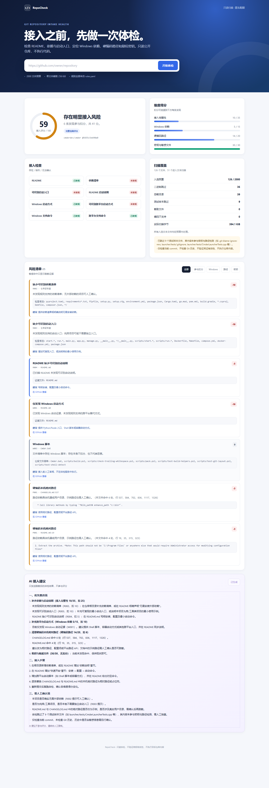
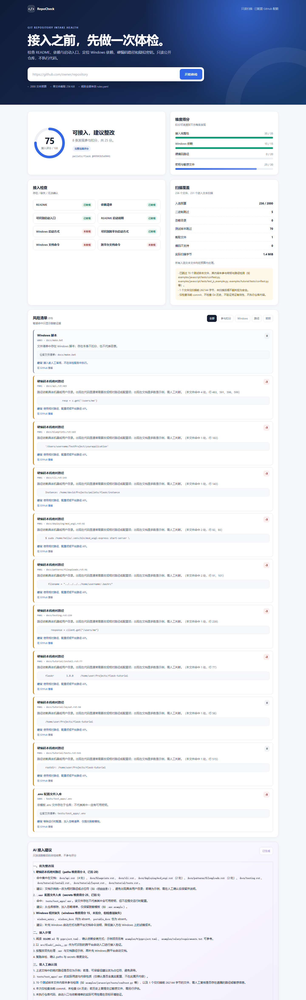

# Git 仓库接入体检

输入公开 GitHub 仓库链接，固定默认分支当前 commit，只读扫描 README、依赖清单、启动入口、Windows 脚本、硬编码路径和疑似密钥，输出 100 分制评分、可追溯风险清单和覆盖率。

## 运行

需要 Python 3.10+。

```powershell
python -m venv .venv
.\.venv\Scripts\pip.exe install -r requirements.txt
$env:GITHUB_TOKEN = "只读 token（可选）"
.\.venv\Scripts\uvicorn.exe app.main:app --reload
```

打开 `http://127.0.0.1:8000`。未配置 `GITHUB_TOKEN` 时使用匿名 GitHub 配额。

AI 建议是可选能力，缺省关闭；配置后页面"生成建议"按钮才可用：

```powershell
$env:AI_API_KEY  = "你的 key"
$env:AI_BASE_URL = "https://api.deepseek.com/v1"   # 兼容 OpenAI /chat/completions 的服务均可
$env:AI_MODEL    = "deepseek-chat"
```

AI 调用在线程池里异步执行：`POST /api/scans/{id}/advice` 只负责提交，前端轮询同一个任务拿结果，避免长连接被网关掐断。

## 设计约束

- 使用 `GET /repos/{owner}/{repo}/tarball/{sha}` 流式下载，在内存中顺序解包，不落盘、不执行仓库内容。
- 归档下载、解压量和扫描时长有独立保护上限，超限直接失败，不输出残缺评分。
- 固定相对路径排序，最多处理 2000 个普通文件；超限标记 `partial`。
- 单文件只扫描前 262144 字节，超出部分截取而非跳过，标记 `truncated`；截取只写入限制说明，不降低扫描状态。
- 二进制、忽略目录和不支持的编码单独计入覆盖率。
- 测试样本目录（`tests/`、`__tests__/`、`fixtures/`、`*.test.*`、`test_*.py` 等）不参与内容检测：测试里为验证规则而构造的假密钥、假路径不是真实泄露。跳过数量写入 `limitations` 和 `coverage.content_skipped_files`，不静默丢弃。`README.md` 与 `docs/` 不排除，文档中出现密钥仍然算风险。
- 同一 commit、同一引擎与规则版本得到相同分数；时间、AI 输出和请求完成顺序不参与评分。
- 所有检测规则、正则、权重、例外和上限在 `rules.yaml`；Python 只实现通用执行器。
- `GITHUB_TOKEN` 只从服务端环境变量读取，不进入页面、不返回前端。归档重定向到 codeload 时不转发 token。

## 评分

| 维度 | 满分 |
|---|---:|
| 接入完整性 | 35 |
| Windows 依赖 | 15 |
| 硬编码路径 | 20 |
| 密钥与敏感文件 | 30 |

总分是 `max(0, 100 - 实际扣分之和)`。各维度扣分不超过满分，得分不低于 0。密钥规则按 `once_per_rule` 只计一次，密钥维度最多扣 30 分。每条 finding 的 `proposed_deduction`、`applied_deduction` 和 `deduction_reason` 可在报告中查看。

## API

- `POST /api/scans`，请求体 `{"url":"https://github.com/owner/repo"}`，返回任务 ID。
- `GET /api/scans/{id}`，返回排队、进度或最终报告。
- `POST /api/scans/{id}/advice`，可选 AI 建议。
- `GET /api/health`，返回 token 和 AI 是否配置。

任务状态保存在内存中，有 TTL 和容量上限，重启后清空。

## 可选 AI 建议

设置 `AI_API_KEY`、`AI_BASE_URL` 和 `AI_MODEL` 后，页面可请求接入建议。发送内容只有脱敏 finding、检查状态和覆盖信息；AI 输出不参与评分。接口使用 OpenAI 兼容的 `/chat/completions` 格式。

## 测试

```powershell
.\.venv\Scripts\pytest.exe -q
```

测试覆盖确定性、密钥去重与封顶、256 KiB 截取、2000 文件预算、二进制跳过、Windows 证据、路径变体（盘符、`/home/`、UNC）、BOM 处理、测试样本排除、URL 校验。

前端不只靠肉眼：三个脚本都是可重复执行的检查。

| 脚本 | 检查什么 | 为什么需要 |
| --- | --- | --- |
| `check_frontend.py` | 资源引用是否存在、JS 用到的 DOM id 是否都在页面里、`node --check` 语法、报告字段依赖 | 改模板最容易漏 id |
| `check_js_scope.py` | `const` 声明后又被赋值的地方 | 浏览器只在执行到那一行才报 `Assignment to constant variable`，`node --check` 看不出来 |
| `probe_frontend.py` | 用无头 Chrome 打开真实任务页，读状态条与 console | 只有真跑一遍才知道渲染有没有炸 |

`probe_frontend.py` 里的 `run_chrome()` 和出 README 截图用的是同一套无头 Chrome 调用，截图不是手改的。

## 更新跟踪

原仓库更新后，工具如何给出新报告：

**怎么发现更新**

不轮询整包，只看一个廉价信号：`GET /repos/{owner}/{repo}/commits/{branch}`（`per_page=1`）取默认分支最新 commit 的 `sha` 和 `commit.committer.date`。与上次记录比对，`sha` 不同才触发新扫描。单次请求即可判定，不需要 tarball。若仓库配置了 Webhook，可直接用 `push` 事件里的 `after` 字段作为同一信号的推送版本。

**怎么避免全量重算**

报告按 `(owner, repo, commit_sha, engine_version, rules_digest)` 缓存。四个键全等即复用；只改规则或改引擎版本时，已有 tarball 可复用，但重跑分析层。分析层本身分两段：文件级检测（内容正则、路径规则）的结果按 `(path, blob_sha)` 缓存，跨 commit 复用——Git 的 blob 地址由内容决定，未改动的文件 blob 不变，直接命中缓存；只有新增或修改的文件重新扫描。因此一次小提交通常只重扫少数文件。评分与风险排序始终全量重算，因为它是文件级结果的聚合，成本远低于 I/O 和正则匹配。

**报告如何标注所基于的 commit**

报告顶层固定写入 `commit_sha`（40 位完整 SHA，不是短 SHA）、`repository.ref`、`engine_version`、`rules_digest`；每条 finding 的 `source_url` 直接指向 `/{owner}/{repo}/blob/{commit_sha}/{path}#L{line}`，点开就是当时那个版本的行。这样报告与代码版本一一对应，仓库后续更新不会让旧报告"漂移"成描述新代码。若需要阅读更新的版本，生成新报告即可，旧报告保持可复现。

**失败或限流时怎么兜底**

- 403/429 且有 `X-RateLimit-Reset`：按 `Retry-After` 或重置时间退避重试，最多 N 次，指数退避。
- 匿名配额（60 次/小时）耗尽：报告标记 `stale`，继续展示上一份结果，并在页面明确标注"数据基于 commit X，更新检查失败，原因：配额耗尽"，而不是清空或伪造。
- tarball 下载或解包失败：不覆盖旧报告，仅记录失败事件；连续失败达阈值才提示仓库不可达。
- 结果是幂等的：同一 commit 重扫得到相同分数，所以重试不会产生抖动的报告。

**现在真正跑起来的部分（其余照设计留着，还没实现）**

- 同仓库短时间重复提交：`refresh_ttl_seconds`（默认 300 秒）内的第二次及以后请求直接复用上一份结果，接口返回 `reused: true` 与 `cached_commit`。
- 同一仓库正在扫描时并发提交：并入进行中的任务（`merged_into` 指向源任务），不重复消耗 GitHub 配额。
- 结果缓存：`cache_ttl_seconds`（1800 秒）+ `cache_capacity`，只缓存已完成的报告。
- 限流提示：匿名配额耗尽时错误信息会带上「匿名配额每小时 60 次，约 N 分钟后重置」，而不是笼统的失败。

## 界面

两张都是真实截图，页面左侧是接入评分与四项检查，右侧是各维度得分与扫描覆盖，中间风险清单可按"参与扣分 / Windows / 路径 / 密钥"筛选，底部是为该报告实时生成的 AI 接入建议。数字全部来自对应那次扫描，没有手工修饰。

**例一：`cmderdev/cmder` @ `5655c5e`，59 分**——有 `.bat`/`.ps1`，CHANGELOG 里留着大量盘符路径，是"Windows 工具接进来会踩什么坑"的典型样本。



**例二：`pallets/flask` @ `49943b5`，75 分**——跨平台 Python 项目：README 与依赖齐全，Windows 支持缺失，硬编码路径全部集中在 `docs/` 的示例里、代码本身干净。这条最能说明"命中不等于缺陷"：清单里有 13 条路径命中，扣分是整个维度 20 分全扣，需要人看一眼才知道该改文档还是改代码。



## 已知边界

- 只检查当前 commit，不检查 Git 历史。
- 不验证疑似密钥是否有效，不判断仓库是否恶意。
- 缺失项只代表在已扫描范围内未发现；文件预算不足时显示“无法确认”或 `partial`。
- 纯库项目可能因没有独立启动入口被扣分，报告会保留该评分口径。

## 样例报告

[`docs/samples/gitscan-self.json`](docs/samples/gitscan-self.json) 是本项目自扫结果（74 分，基于 commit `8f5f896`；扣分项只有 README 缺 Windows 启动方式、README 缺可识别启动入口，以及两个前端检查脚本里的本机路径——后者已改成相对 `__file__`，属于"工具扫自己"会照出来的真实问题），[`docs/samples/hello-world.json`](docs/samples/hello-world.json) 是 `octocat/Hello-World`（75 分），[`docs/samples/cmder.json`](docs/samples/cmder.json) 是 `cmderdev/cmder`（59 分，含 Windows 脚本、CHANGELOG 里的大量盘符路径）。三份都是真实拉取的真实报告，可直接对照 `limitations` 与 `coverage` 查看工具在哪些地方"没看到"。

## AI 使用

见 [`AI_USAGE.md`](AI_USAGE.md)。其中记录 7 条 AI 答错并被复核发现的例子，包括把"截断读取"擅自改成"跳过"、密钥扣分不封顶、逐文件拉取在匿名配额下不可行、路径正则漏掉一半盘符。
